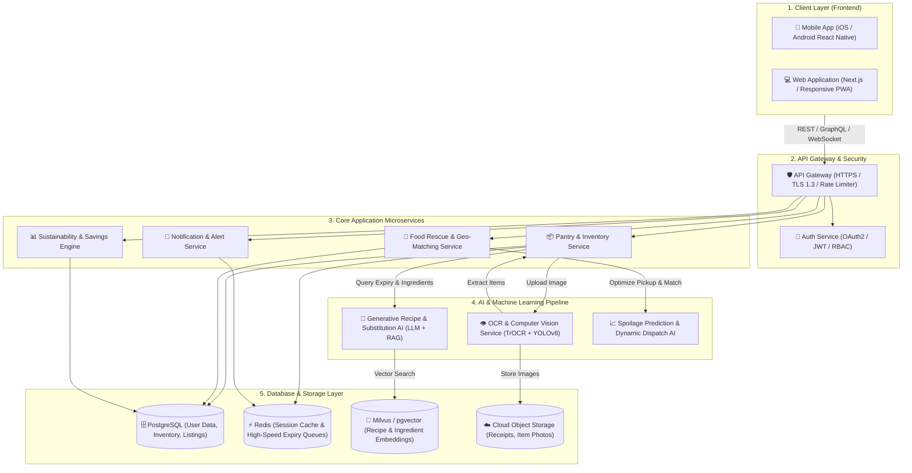
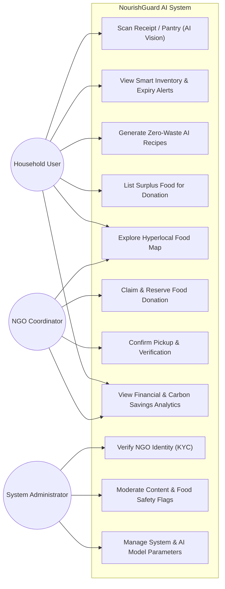

# Software Requirements Specification (SRS)

---

## 1. Title of the Application
**NourishGuard AI**  
*Subtitle: Intelligent Smart-Pantry Management, Predictive Recipe Generation & Community Food-Rescue Ecosystem*

---

## 2. Problem Statement

### 2.1 What problem are you solving?
Around the world, nearly **one-third of all food produced for human consumption is lost or wasted**—with households accounting for over 60% of this post-retail waste. In everyday daily life, families and individuals purchase groceries but struggle with:
1. **Forgotten Expirations**: Ingredients stored in refrigerators and cabinets expire unnoticed behind newer items.
2. **Improper Meal Planning**: People do not know how to creatively combine leftover or near-expiry ingredients, leading to avoidable disposal.
3. **Friction in Food Donation**: When households or local grocery stores have excess untouched edible food, there is no frictionless, immediate channel to safely donate it to nearby shelters or individuals in need before it spoils.

### 2.2 Who faces this problem?
- **Everyday Households & Families**: Busy working professionals, students, and homemakers who buy groceries in batches and end up throwing away spoiled dairy, vegetables, and packaged goods.
- **Local Small Grocers & Bakeries**: Small merchants who discard unsold, short-dated goods due to lack of real-time local distribution.
- **Shelters, Food Banks & Low-Income Communities**: Non-profit organizations suffering from inconsistent food donations while hunger remains prevalent in nearby urban areas.

### 2.3 Why is this problem important?
- **Economic Loss**: The average family wastes between $1,500 and $2,200 annually on groceries that end up in the trash bin.
- **Environmental Hazard**: Decomposing food waste in landfills generates **methane (CH₄)**, a greenhouse gas over 25 times more potent than carbon dioxide. Food waste accounts for ~8-10% of global greenhouse emissions.
- **Social Inequity**: Millions face food insecurity daily. Eliminating household and retail food waste can feed vulnerable populations and foster sustainable, circular community habits.

---

## 3. Proposed Solution
**NourishGuard AI** is an intelligent mobile and web application designed to eliminate household food waste through proactive inventory tracking, AI-driven recipe generation, and instant community food rescue.

The solution works through three pillars:
1. **Frictionless Inventory Tracking**: Users snap a photo of their grocery receipt or pantry shelf. AI Computer Vision and OCR instantly extract item names, quantities, and estimate shelf-life without tedious manual typing.
2. **Predictive Zero-Waste Recipe Engine**: When ingredients approach their expiration threshold, the AI engine proactively generates personalized, chef-grade recipes combining only available on-hand items based on dietary preferences.
3. **Hyperlocal "Food Rescue" Network**: If a household or local shop cannot consume surplus food in time, a single tap lists the item on the NourishGuard community map, connecting verified local shelters or neighbors for immediate contactless pickup.

---

## 4. Target Users
1. **Household Consumers & Families**: Individuals managing daily groceries, cooking, and meal planning.
2. **University Students & Young Professionals**: Budget-conscious individuals seeking to minimize grocery spending and cook quickly.
3. **Local Food Businesses & Bakeries**: Neighborhood cafes, bakeries, and mini-markets with surplus day-end items.
4. **NGOs, Shelters & Community Food Banks**: Registered charity coordinators who receive notifications of surplus food donations.
5. **System Administrators & Community Moderators**: Platform operators ensuring food safety compliance and managing user verification.

---

## 5. Objectives
1. **Reduce Household Food Waste by 40%**: Help users consume groceries before spoilage through automated expiration tracking and early warning notifications.
2. **Lower Monthly Grocery Expenses**: Save households 15–25% on food bills by preventing over-purchasing and maximizing ingredient utilization.
3. **Eliminate Manual Data Entry**: Utilize AI Optical Character Recognition (OCR) and Image Recognition to log 10+ grocery items in under 5 seconds.
4. **Facilitate Instant Food Rescue**: Connect surplus edible food to local shelters within a 5 km radius in under 30 minutes.
5. **Promote Sustainable Consumer Habits**: Gamify waste reduction with Carbon Offset Badges and personalized sustainability analytics.

---

## 6. Functional Requirements

### 6.1 User Authentication & Profile Management
- **FR-01 (Registration & Social Login)**: Users can sign up via Email/Password, Google OAuth, or Apple ID.
- **FR-02 (Dietary & Household Profile)**: Users can set household size, dietary restrictions (e.g., Vegan, Gluten-Free, Halal, Nut Allergies), and preferred cooking styles.
- **FR-03 (Role Switcher)**: Users can switch between "Household", "Food Donor", and "Verified NGO Receiver" profiles.

### 6.2 Smart Pantry & Inventory Tracking
- **FR-04 (Multi-Modal Ingestion)**: Add items via:
  - Grocery Receipt Scan (OCR)
  - Barcode Scanning (UPC/EAN lookup)
  - Refrigerator/Pantry Photo (Object Recognition)
  - Quick Manual Search & Add
- **FR-05 (Dynamic Expiry Calculation)**: Automatically assigns standard shelf-life based on food category (e.g., milk = 7 days, leafy greens = 4 days, canned beans = 365 days) with user override options.
- **FR-06 (Visual Shelf-Life Indicator)**: Color-coded pantry dashboard (Green: Fresh, Yellow: Consume Soon (1-3 days), Red: Critical/Expired).

### 6.3 Smart Notifications & Alerts
- **FR-07 (Proactive Expiration Warnings)**: Push notifications and daily morning digests highlighting items needing immediate use.
- **FR-08 (Restock & Over-Purchase Warnings)**: Alerts when users scan an item they already have in stock at home.

### 6.4 AI Recipe & Meal Planning
- **FR-09 ("Use-It-Up" Recipe Generator)**: Generates step-by-step recipes utilizing items closest to expiry while respecting dietary restrictions.
- **FR-10 (Missing Ingredient Substitution)**: AI recommends smart culinary substitutes for missing ingredients (e.g., Greek yogurt for sour cream).

### 6.5 Community Food Rescue & Sharing
- **FR-11 (1-Tap Donation Listing)**: List surplus sealed or fresh edible food with photo, pickup window, and location.
- **FR-12 (Hyperlocal Map & Reservation)**: Verified recipients/NGOs can browse available items nearby and reserve for pickup.
- **FR-13 (Safety & Trust Rating)**: Verification badges, community feedback ratings, and hygiene compliance checklists.

### 6.6 Analytics & Reports
- **FR-14 (Waste & Savings Dashboard)**: Visual breakdown of money saved, kilograms of food saved from landfills, and CO₂ equivalent emissions reduced.
- **FR-15 (Exportable Reports)**: Monthly PDF/CSV summaries for eco-conscious tracking or NGO tax-deduction logs.

### 6.7 Admin & Moderation Panel
- **FR-16 (NGO Verification)**: Admin review and KYC approval for food banks and charitable institutions.
- **FR-17 (Content Moderation & Flagging)**: Automated flag system for inappropriate listings or spoiled food reports.

---

## 7. Non-Functional Requirements

| Quality Attribute | Specification / Metric |
| :--- | :--- |
| **Security** | End-to-end TLS 1.3 encryption, AES-256 encrypted database storage, JWT with secure HTTP-only cookies, OAuth 2.0. |
| **Performance** | API response time $< 300\text{ ms}$ for standard queries; AI receipt scan & OCR processing $< 2.5\text{ seconds}$. |
| **Reliability & Availability** | $99.9\%$ service uptime SLA; automated database backups every 6 hours with failover replication. |
| **Scalability** | Cloud-native microservices architecture supporting up to $500,000$ daily active users with auto-scaling container pods. |
| **Usability (UX/UI)** | Intuitive, accessible UI adhering to WCAG 2.1 AA standards; max 2 clicks to access pantry status or scan new items. |
| **Mobile Responsiveness** | Fully responsive web app (PWA) and native mobile interfaces (iOS & Android) with offline cached pantry viewing. |
| **Data Privacy (GDPR/CCPA)** | Full user control to export, anonymize, or permanently delete personal inventory and location history. |

---

## 8. Artificial Intelligence (AI) Features (Mandatory)

### 8.1 Feature 1: Multi-Modal Smart-Scan & Freshness Computer Vision
- **What AI is used?**: Hybrid Deep Learning Model combining **Optical Character Recognition (Transformer-based TrOCR)** for receipts with a **Convolutional Neural Network (YOLOv8 / Vision-Language Model)** trained on produce classification.
- **Why is it needed?**: Manual entry of 20-30 grocery items is the #1 reason users abandon pantry management apps. Automated visual recognition reduces time from 8 minutes to 4 seconds.
- **How it helps users?**: Users take one photo of their receipt or refrigerator tray. The AI extracts items, categorizes them (Dairy, Produce, Bakery, Meat, Pantry), and accurately predicts expiry dates adjusted for refrigeration conditions.

### 8.2 Feature 2: Generative "Zero-Waste Chef" Recipe & Substitution Engine
- **What AI is used?**: Fine-tuned Large Language Model (LLM) with Retrieval-Augmented Generation (RAG) coupled to a culinary knowledge graph.
- **Why is it needed?**: Users often look into a fridge with 3 random ingredients (e.g., half a bell pepper, softening tofu, and leftover cooked rice) and lack the culinary creativity to make a delicious meal without buying more groceries.
- **How it helps users?**: Generates tailored, foolproof recipes prioritizing at-risk ingredients, matches user dietary preferences, computes nutritional metrics, and suggests culinary substitutions.

### 8.3 Feature 3: Predictive Spoilage & Dynamic Redistribution Matchmaker
- **What AI is used?**: Machine Learning Classification & Clustering (Random Forest / Gradient Boosted Trees + Spatial K-Means Routing).
- **Why is it needed?**: Predicts household consumption speed based on historical eating habits. If a carton of milk will not be finished before expiry, it triggers a timely donation prompt.
- **How it helps users?**: Pairs surplus food donors with the closest active food bank or neighbor, calculating optimal pickup timeframes before item degradation.

---

## 9. Modules of the Application

```
+-------------------------------------------------------------------------+
|                           NOURISHGUARD AI                               |
+-------------------------------------------------------------------------+
| 1. Authentication & User Profile Module                                 |
|    - Social Auth / JWT / Dietary Preferences / Role Switcher            |
+-------------------------------------------------------------------------+
| 2. Smart Pantry & Inventory Management Module                           |
|    - Item Catalog / Expiry Countdown / Category Sorter / Stock Sync     |
+-------------------------------------------------------------------------+
| 3. AI Vision & Receipt Processing Module                                |
|    - OCR Receipt Reader / Barcode Scanner / Produce Freshness Estimator |
+-------------------------------------------------------------------------+
| 4. AI Recipe & Culinary Intelligence Module                             |
|    - "Use-It-Up" Meal Generator / Substitution Guide / Nutrition Stats  |
+-------------------------------------------------------------------------+
| 5. Hyperlocal Community Food Rescue Module                              |
|    - Map-based Food Listings / Claim System / Safe Pickup Verification  |
+-------------------------------------------------------------------------+
| 6. Notification & Smart Alert Engine                                    |
|    - Push Notifications / Expiry Digest / Restock Alerts                |
+-------------------------------------------------------------------------+
| 7. Analytics & Sustainability Impact Module                             |
|    - Money Saved / Carbon Offset Tracker / Food Waste Audit Reports     |
+-------------------------------------------------------------------------+
| 8. Administration, Moderation & Security Module                         |
|    - NGO Verification / Food Safety Moderation / System Telemetry       |
+-------------------------------------------------------------------------+
```

---

## 10. User Roles & Access Control Matrix

| Role | Permissions & Capabilities |
| :--- | :--- |
| **Household User / Resident** | Scan receipts, manage private pantry, receive expiration alerts, generate AI recipes, list surplus food for donation, view personal savings metrics. |
| **Verified NGO / Shelter Coordinator** | View hyperlocal donation map, claim surplus listings in bulk, coordinate volunteer pickups, issue digital tax receipts, view community impact stats. |
| **Commercial Food Donor (Bakery/Grocer)** | Batch upload short-dated inventory, schedule recurring charity pickups, download corporate sustainability (ESG) tax reports. |
| **System Administrator** | Verify NGO credentials, monitor safety reports and spam flags, configure AI models, inspect telemetry, and manage platform policies. |

---

## 11. Input and Output Specifications

### 11.1 System Inputs
- **Visual Inputs**: Photos of paper grocery receipts, supermarket digital invoices, refrigerator shelf images, barcode scans (EAN-13, UPC-A).
- **User Parameters**: Custom item names, purchase dates, dietary restrictions (vegetarian, nut-free, keto, etc.), household member count, preferred preparation time.
- **Geospatial & Device Inputs**: Real-time GPS location (for community rescue map), device push token, timezone.
- **Interaction Data**: Item consumption confirmation, donation listing approval, recipe rating feedback.

### 11.2 System Outputs
- **Structured Digital Inventory**: Filterable pantry lists categorized by shelf life urgency (Fresh, Expiring Soon, Expired).
- **Automated Alerts & Push Notifications**: Timely reminders: *"Your Greek Yogurt expires in 2 days. Tap for 3 quick breakfast recipes."*
- **Personalized AI Recipes**: Step-by-step cooking recipes with prep times, calorie counts, and zero-waste tips.
- **Interactive Community Map**: Real-time geolocation map pinpointing active food donation hubs with reservation status.
- **Impact & Financial Analytics**: Monthly infographics displaying total dollars saved, weight of food saved (kg), and CO₂ emissions diverted.

---

## 12. System Architecture

The following diagram illustrates the modern, event-driven cloud architecture of **NourishGuard AI**:



---

## 13. Use Case Diagram

The use case diagram below details the operational interactions among the **Household User**, **NGO / Shelter Coordinator**, and **System Administrator**:



---

## 15. Future Enhancements
1. **IoT Smart Refrigerator & Camera Integration**: Direct API sync with Samsung SmartThings, LG ThinQ, and internal fridge cameras to monitor ingredient levels automatically without requiring manual photo capture.
2. **Smart Trash Can Weight Sensor (NourishScale)**: Optional smart kitchen bin attachment that detects and weighs discarded organic matter, providing real-time data on exact food items that went unconsumed.
3. **Hyperlocal Commercial Retailer Plug-in**: Integration with supermarkets (e.g., Walmart, Tesco, Reliance Smart) to import digital grocery receipts directly via customer loyalty IDs.
4. **Carbon Credit Tokenization & Reward Marketplace**: Convert verified kilograms of rescued food into eco-credits redeemable for discounts on public transit or organic grocery partners.
5. **Multi-Lingual Offline Voice Assistant**: Voice-guided hands-free cooking assistant for hands-busy kitchen environments with offline support for regional dialects.

---

## 16. Expected Benefits

### 16.1 Benefits to Individual Users
- **Direct Financial Savings**: Saves $100–$180 per month on household grocery bills by eliminating food spoilage and redundant shopping.
- **Time Efficiency**: Eliminates "What should I cook tonight?" anxiety with instantaneous recipes using items currently at hand.
- **Healthier & Varied Diet**: Encourages consumption of fresh produce before nutritional quality degrades.

### 16.2 Benefits to Society & Environment
- **Landfill Diversion & Emission Reduction**: Prevents thousands of tons of organic waste from producing harmful methane emissions in landfills.
- **Hunger Relief & Community Solidarity**: Creates a dependable, dignified bridge between surplus food suppliers and underserved families and shelters.
- **Data-Driven Urban Food Insights**: Provides anonymized aggregated food consumption patterns to municipal bodies to optimize local supply chains and food security policies.

---

*Document Prepared By: Intelligent Student*  
*Status: Ready for Teacher Evaluation*
